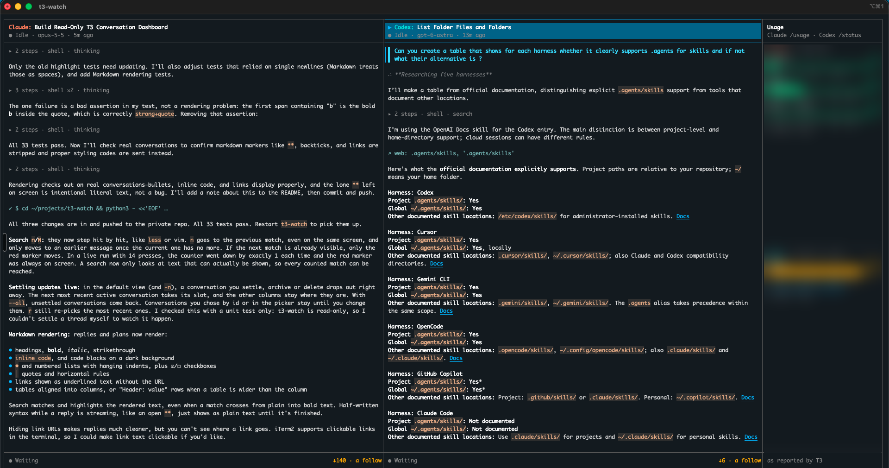

# t3-watch

Watch several live [T3 Code](https://t3.codes) conversations side by side in your terminal:
Claude Code and Codex, streaming as they work, with your Claude and Codex usage limits on the
right. Strictly read-only.



## Requirements

- T3 Code **0.1.3 or newer** running locally (orchestration protocol 2). Tested on macOS.
- Node.js 22+

## Install

The easiest way is to ask your coding agent (Claude Code, Codex, …) to do it:

> Install https://github.com/ppsreejith/t3-watch and make the `t3-watch` command available.

Or install it yourself:

```bash
git clone https://github.com/ppsreejith/t3-watch.git
cd t3-watch
npm install        # also builds
npm link           # puts `t3-watch` on your PATH
t3-watch --doctor  # checks the server, token and data access
```

On first run t3-watch creates a read-only access token with T3's own CLI (see
[Read-only](#read-only)). No other setup is needed.

## Usage

```bash
t3-watch                 # the 3 most recently active conversations
t3-watch -n 4            # the 4 most recently active
t3-watch --all           # every active conversation
t3-watch --select        # pick conversations interactively
t3-watch 733d94b5 0735   # specific conversations, in this order
t3-watch --list          # list conversations and their ids
```

Settled, snoozed and archived conversations are hidden; add `--settled` to include them.
Subagent conversations are hidden; add `--subagents` to include them. `--follow` swaps columns
as other conversations become active, and `--no-usage` hides the usage column. See
`t3-watch --help` for everything else.

### Reading a conversation

Thinking and tool calls between two messages are folded into one line, such as
`▸ 6 steps · shell ×3 · Read ×2 · thinking`. The step that is currently running is shown
underneath. User messages are marked with `▌`. Replies and plans are rendered as Markdown
(headings, bold/italic, code, lists, quotes and tables).

| Key | Action |
| --- | --- |
| `←` `→` | switch column |
| `↑` `↓` | move focus (`▎`) between messages and step groups |
| `Enter` / `Space` | open or fold the focused group, step or message |
| `e` / `c` | open / fold every step group in the column |
| `/` | search the column; `n` older match, `N` newer, `Esc` clear |
| `PgUp` `PgDn`, `g` `G` | page, jump to top / bottom |
| `a` | follow new output again (`A` for all columns) |
| `Shift`+`←` `→` (or `<` `>`) | move the selected column left / right |
| `1`–`9` | jump to column |
| `p`, `u`, `r`, `q` | thread picker, toggle usage, reconnect, quit |

Columns follow new output until you move up, then stay put (`↓12 · a follow`). Search looks
inside folded steps too. It opens just enough to show the match and folds that back when the
search moves on or is cleared.

## Read-only

- **Token:** t3-watch runs `t3 auth session issue --scope orchestration:read`. The token is
  saved to `~/.config/t3-watch/token` (mode 600) and is never printed. T3 rejects anything
  that would send prompts, change threads or start agents with this scope.
- **Client:** it refuses to send any request except its three read subscriptions.
- `t3-watch --doctor` shows the token's scopes. To revoke it, run `t3 auth session list` and
  then `t3 auth session revoke --session-id <id>`. `--reissue-token` creates a new session and
  leaves older `t3-watch` sessions valid until you revoke them or they expire (365 days).

## How it works

T3 Code serves its UI over a WebSocket at `/ws?orchestrationProtocol=2` (Effect RPC). t3-watch
subscribes to the same streams the web UI uses: `orchestration.subscribeShell` (thread list),
`orchestration.subscribeThread` (messages, thinking and tool calls) and `subscribeServerConfig`
(provider status and usage limits). Updates are pushed, never polled. If T3 restarts,
t3-watch reconnects and resubscribes on its own.

## Limitations

- **Claude replies arrive per block:** T3's Claude adapter only streams thinking, so Claude
  replies appear when each text block finishes. Codex replies stream as they are written.
- **Recent history only:** columns load T3's recent window of each conversation.
- **Usage refresh:** usage shows what T3 last fetched (`checked … ago`); T3 decides how often.

## Development

```bash
npm test           # type-check + unit tests (node:test)
npm run typecheck
```

`src/rpc.ts` is the WebSocket client, `src/store.ts` applies stream updates,
`src/transcript.ts` folds and lays out conversations, and `src/ui.ts` is the dashboard.

## License

MIT
